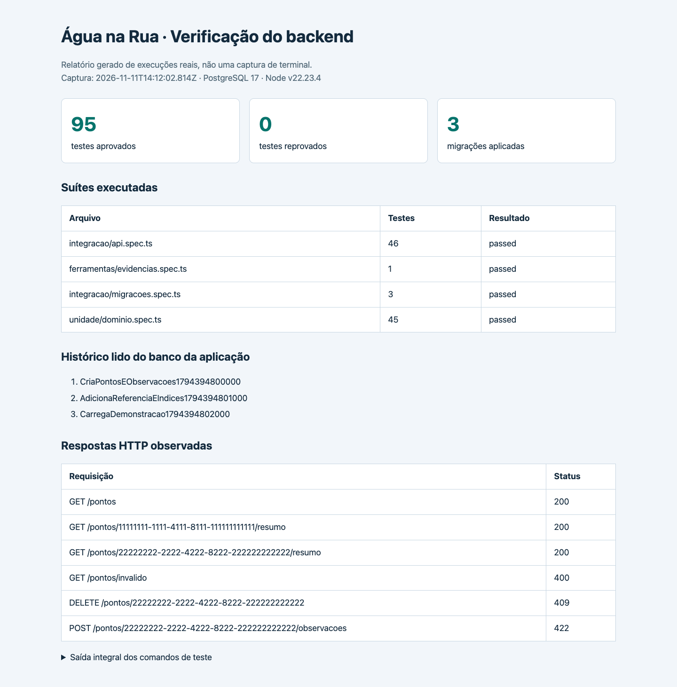
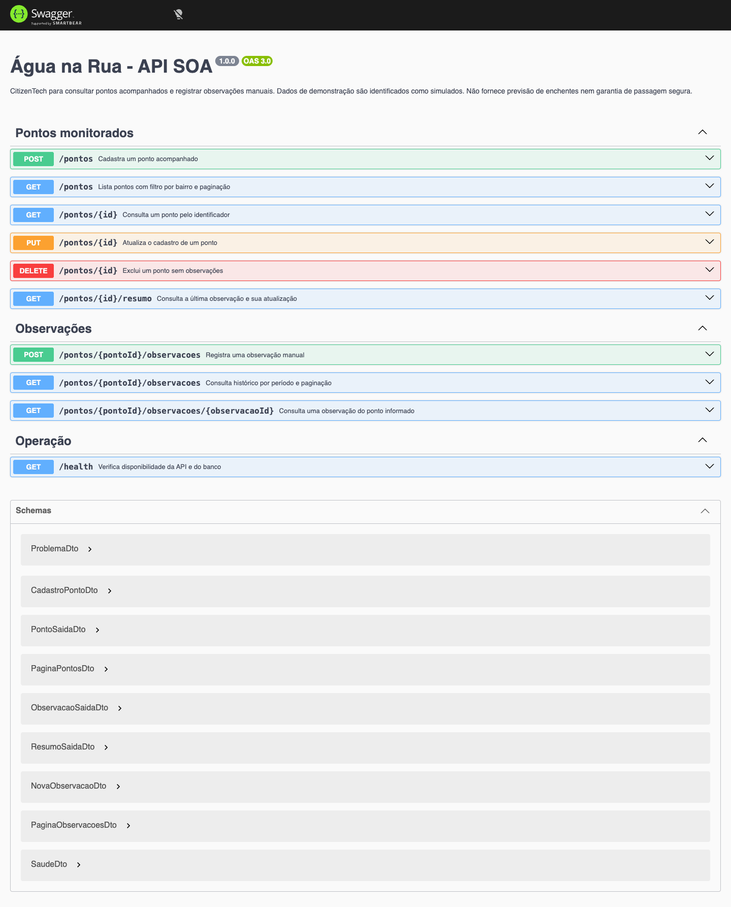
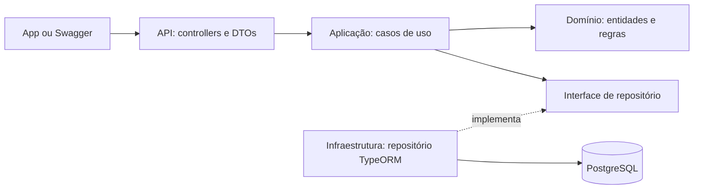

# Ficha da CitizenTech — Água na Rua

- **Nome:** Água na Rua.
- **Cidade e bairro:** São Paulo — Jardim Peri, com seleção de ruas e pontos específicos após validação com moradores.
- **Cidadão beneficiado:** moradores que precisarão circular por trechos sujeitos a alagamento, especialmente ao sair ou retornar do trabalho.
- **Problema em uma frase:** quem depende de ruas sujeitas a alagamento enfrenta dificuldade para encontrar informações recentes e localizadas sobre água acumulada no seu caminho.
- **Como funcionará:** o cidadão consultará pontos acompanhados, visualizará a última observação com horário e origem, salvará favoritos e poderá registrar uma nova ocorrência.
- **O que cada parte fará:** o software organizará as observações; o ML investigará padrões históricos de alagamento; o circuito demonstrará monitoramento local da elevação da água; infraestrutura, segurança e testes sustentarão a proposta.
- **Indicador de impacto:** será medido o tempo para encontrar a informação mais recente sobre um trecho. Também será avaliado se o usuário identificará corretamente sua origem, atualização e eventual ausência de informação.
- **ODS relacionados:** **ODS 11, meta 11.5**, pela contribuição ao acesso à informação sobre desastres relacionados à água; **ODS 13, meta 13.1**, pelo apoio à preparação e adaptação comunitária. O protótipo não comprovará redução de danos ou vítimas.
- **Link do repositório:** [agua-na-rua-GS-SOA-2026](https://github.com/CezarBacanieski/agua-na-rua-GS-SOA-2026).

---

# Backend de SOA e Web Services

API independente em **Node.js, TypeScript, NestJS, TypeORM e PostgreSQL**, desenvolvida para a Global Solution 2026.2 da FIAP. 

## Executar localmente

Pré-requisitos: Node.js **22.13+ na linha 22 ou 24.11+**, npm e Docker com Compose em execução. O ambiente usado está em `.nvmrc`; as versões das bibliotecas estão fixadas em `package.json` e `package-lock.json`.

Clone o repositório e execute na raiz do projeto:

```bash
git clone https://github.com/CezarBacanieski/agua-na-rua-GS-SOA-2026.git
cd agua-na-rua-GS-SOA-2026
npm ci
npm run setup
npm run db:init
npm start
```

`setup` cria um `.env` com senha aleatória de desenvolvimento, sem exibi-la e sem substituir um arquivo existente. `db:init` sobe o PostgreSQL e aplica todas as migrações, inclusive os dados fictícios. Esse é o comando para construir o banco do zero; também pode ser repetido sem duplicar o seed.

A aplicação recusa iniciar se houver migrações pendentes. A criação do esquema é feita pelas migrações, com `synchronize: false` e `migrationsRun: false`.

Abra:

- **Swagger UI:** <http://localhost:3000/docs>
- **Contrato OpenAPI gerado:** <http://localhost:3000/openapi.json>
- **Pontos acompanhados:** <http://localhost:3000/pontos>
- **Saúde da API e do PostgreSQL:** <http://localhost:3000/health>

Para desenvolver com reinício automático, use `npm run start:dev`. Para parar a API, pressione Ctrl+C. `npm run db:down` para o banco preservando os dados no volume Docker; `npm run db:up` o inicia novamente.

Se a porta do banco estiver ocupada, altere `DB_PORT` em `.env` e repita `npm run db:up`. A porta padrão é 55432, para evitar conflito com PostgreSQL já instalado na porta 5432. `PORT` configura a API.

O `.env.example` documenta a configuração sem credenciais reais. Nest lê as variáveis de ambiente, com `.env` como apoio local; em um servidor, forneça as mesmas variáveis ao processo. `CORS_ORIGINS` permite configurar as origens de um futuro frontend web.

## Testes com um comando

```bash
npm test
```

O comando inicia um **segundo PostgreSQL descartável**, compila, verifica os tipos e executa todas as suítes. Esse banco usa o serviço `db-test`, porta 55433 e nome `agua_na_rua_test`, com dados em `tmpfs`. O banco de desenvolvimento e seu volume não são usados pelos testes. Existem verificações de ambiente, host, porta e nome antes de qualquer limpeza do banco de testes.

Outros comandos:

```bash
npm run test:unit
npm run test:coverage
npm run build
npm run typecheck
```

As suítes verificam:

- Regras puras de cadastro, horários, atualização, identidade territorial e preservação de histórico.
- CRUD, Location, persistência após fechar e recriar API e conexão, filtros, paginação e consultas por período.
- Observações recentes e antigas, ausência de informação, relatos fora de ordem e desempate estável.
- Entradas inválidas e respostas 400, 404, 409 e 422.
- Criação e evolução do banco, preenchimento de um registro da versão anterior, seed sem duplicação, rollback e chave estrangeira RESTRICT.
- OpenAPI com todos os endpoints, exemplos, erros e parâmetros de paginação utilizáveis pelo Swagger.

A execução registrada teve **95 testes aprovados em quatro suítes**. A quarta suíte verifica que uma execução interrompida antes do Jest invalida resultados anteriores e bloqueia capturas de evidências. O relatório de cobertura considera apenas domínio e aplicação: **98,05% das linhas e 100% das funções**. Isso não representa cobertura de todo o projeto.

[Saída dos comandos](evidencias/testes.txt) · [Print da saída real](evidencias/testes-saida.png) · [Resultado estruturado](evidencias/testes.json) · [Estado da última execução](evidencias/ultima-execucao.json) · [Relatório visual](evidencias/relatorio.html)



## Endpoints

| Método | Rota | Comportamento |
|---|---|---|
| POST | `/pontos` | Cadastra ponto; retorna 201 e Location |
| GET | `/pontos` | Lista por bairro, com paginação |
| GET | `/pontos/{id}` | Consulta cadastro |
| PUT | `/pontos/{id}` | Atualiza cadastro completo, preservando identidade territorial |
| DELETE | `/pontos/{id}` | Exclui ponto sem observações; com histórico retorna 409 |
| POST | `/pontos/{pontoId}/observacoes` | Registra relato manual; retorna 201 e Location |
| GET | `/pontos/{pontoId}/observacoes` | Consulta histórico por período, com paginação |
| GET | `/pontos/{pontoId}/observacoes/{observacaoId}` | Consulta um relato do ponto |
| GET | `/pontos/{id}/resumo` | Retorna última observação e atualização |
| GET | `/health` | Verifica API e conexão com banco |

`pagina` começa em 1 e `tamanho` vai de 1 a 100. O filtro `bairro` compara o nome completo sem diferenciar maiúsculas e minúsculas. `de` e `ate` são opcionais, inclusivos e precisam conter fuso horário. O histórico ordena por `observadoEm`, `registradoEm` e `id`, todos em ordem decrescente.

Um ponto existente sem relatos retorna histórico vazio e resumo `SEM_INFORMACAO` com `ultimaObservacao: null`. Ponto inexistente retorna 404. A condição do relato é independente de sua atualização.

Exemplos de consultas após aplicar o seed:

```bash
curl 'http://localhost:3000/pontos?bairro=Jardim%20Peri&pagina=1&tamanho=20'
curl http://localhost:3000/pontos/11111111-1111-4111-8111-111111111111/resumo
curl http://localhost:3000/pontos/22222222-2222-4222-8222-222222222222/observacoes
```

Use o botão **Try it out** no Swagger para cadastrar um ponto com o exemplo do modelo, registrar uma observação e consultar o resumo. Em `observadoEm`, informe um horário igual ou anterior ao atual e inclua `Z` ou um deslocamento como `-03:00`. O exemplo fixo da documentação pode estar antigo; isso deve produzir `ANTIGA` quando ultrapassar a janela configurada.



[Captura de uma consulta executada pelo Swagger](evidencias/swagger-execucao.png) · [Respostas HTTP reais](evidencias/api-respostas.json) · [Cópia exportada do contrato gerado](evidencias/openapi.json)

## Regras do produto

1. Ponto precisa de nome, cidade, bairro, referência, coordenadas válidas e identificação da natureza dos dados. Textos não aceitam caracteres nulos; os limites de comprimento contam caracteres Unicode, de acordo com o PostgreSQL e o contrato.
2. Coordenadas e `dadosSimulados` não mudam em um PUT. Para representar outro local ou outra natureza de dados, cadastre outro ponto. Nome, cidade, bairro e referência podem ser corrigidos.
3. Observação sempre pertence a um ponto existente. Horário futuro é recusado.
4. O serviço atribui `registradoEm` e origem `RELATO_MANUAL`; o consumidor não pode enviar esses campos nem se apresentar como sensor ou fonte oficial.
5. Relatos de pontos simulados também devem ter `dadosSimulados: true`.
6. A janela de informação recente é inclusiva: até 30 minutos na configuração padrão. Ela é ajustável em `JANELA_RECENTE_MINUTOS`, entre 1 e 1440, e continua sendo uma **hipótese do protótipo sem validação operacional**.
7. Sem relato não significa sem alagamento. Relato `SEM_AGUA_APARENTE` também não comprova passagem segura.
8. Relato antigo recebido depois não substitui uma observação de horário mais recente.
9. Ponto com histórico não pode ser excluído; a chave estrangeira também impede a remoção em caso de concorrência.

Os erros seguem `application/problem+json`, com `type`, `title`, `status`, `detail`, `instance` e `code`. Falhas de validação podem trazer `errors`. Erros internos não expõem SQL, stack ou credenciais ao consumidor. Os formatos e exemplos estão no OpenAPI.

## Arquitetura



- `src/dominio/`: TypeScript puro, sem NestJS, HTTP, ORM ou SQL.
- `src/aplicacao/`: casos de uso e contratos de repositório, relógio e geração de identificadores.
- `src/infraestrutura/`: entidades ORM, mapeamento para o domínio, consultas e configuração.
- `src/api/`: DTOs, controllers, erros e composição das dependências.
- `src/migrations/`: histórico explícito do banco.
- `tests/unidade/` e `tests/integracao/`: regras e verificação contra PostgreSQL.

O relacionamento é **PontoMonitorado 1:N Observacao**. A API devolve DTOs de saída, sem serializar entidades ORM. O banco é interno deste serviço; consumidores utilizam o contrato HTTP. O relógio é substituído por um instante fixo nos testes para verificar os limites de atualização sem depender da hora em que eles rodam.

Os testes usam Jest e ts-jest em CommonJS, preservando os metadados dos decorators usados pelo Nest e pelos DTOs. As bibliotecas estão fixadas no lockfile. Overrides de `glob` e `minimatch` atualizam dependências transitivas das ferramentas de teste; a suíte foi executada com essas versões.

## Migrações

| Ordem | Arquivo | Mudança |
|---|---|---|
| 1 | `CriaPontosEObservacoes` | Tabelas, tipos, restrições e chave estrangeira |
| 2 | `AdicionaReferenciaEIndices` | Referência do local, backfill para registros anteriores e índices de consulta |
| 3 | `CarregaDemonstracao` | Três pontos e três observações fictícias, com horários fixos |

```bash
npm run migration:show
npm run migration:run
npm run migration:check
```

`npm run migration:revert` desfaz a última migração e **remove os dados ou campos que ela criou**. Use apenas quando essa perda fizer parte da mudança pretendida. O rollback do seed é recusado se novos relatos dependerem de seus pontos, preservando o histórico.

Para uma alteração futura de modelo, gere e revise uma nova migração:

```bash
npm run migration:generate -- src/migrations/NomeDaMudanca
```

`migration:check` compara o mapeamento ORM ao banco sem criar arquivo ou alterar o esquema. Os testes também verificam essa compatibilidade. Restrições CHECK estão representadas no mapeamento; os índices com expressão ou ordem específica são mantidos pelas migrações e identificados com `synchronize: false` no ORM.

Nunca reescreva uma migração já aplicada. O histórico fica em `historico_migracoes`. O teste de migrações reconstrói o esquema no banco de teste, preserva um cadastro da primeira versão na evolução e verifica o ciclo de rollback.

[Estado das migrações](evidencias/migracoes.txt) · [Histórico consultado do banco](evidencias/migracoes.json) · [Verificação de instalação limpa](evidencias/instalacao-limpa.txt)

## Dados e limites

Os dados do seed são **inteiramente fictícios**, criados pelo grupo para demonstração. Nomes, referências, coordenadas e relatos não comprovam condições atuais de ruas do Jardim Peri. Os horários fixos do seed são de 01/11/2026; o sistema os mostrará como antigos após a janela de atualização.

Favoritos ficam na persistência local do app; ML, sensor Wokwi e backend C# não são necessários para executar esta API. Não há previsão de enchentes, sensor instalado, notificação automática ou autenticação de autores nesta versão. As rotas de escrita são abertas para a demonstração acadêmica local.

A validação com moradores e a escolha de três pontos reais permanecem pendentes. Não foi medido nem comprovado impacto na comunidade.

A auditoria registrada de dependências de produção teve zero vulnerabilidades reportadas. A auditoria completa registrou seis avisos de baixa severidade na cadeia de desenvolvimento Jest/ts-jest, originados de `deepmerge`; essas dependências não fazem parte da instalação de produção. Os relatórios são uma fotografia da data da execução, não uma garantia sobre vulnerabilidades futuras.

[Auditoria de produção](evidencias/auditoria-producao.json) · [Auditoria completa](evidencias/auditoria-completa.json)

## Avaliação e entrega

A entrega reúne o código completo, a descrição da solução, as instruções de execução, os integrantes, a documentação dos endpoints e as evidências da aplicação. Os critérios do enunciado são domínio, banco de dados, migrações, documentação automática e testes.

Integrantes:

- Lorenzo Hayashi Mangini - RM 554901
- Milton Cezar Bacanieski - RM 555206
- Vitor Bebiano Mulford - RM 555026
- Victório Maia Bastelli - RM 554723

O registro de uso de IA desta entrega está em [prompts.md](prompts.md).

Código e evidências publicados no repositório público [agua-na-rua-GS-SOA-2026](https://github.com/CezarBacanieski/agua-na-rua-GS-SOA-2026). O link da ficha foi preenchido. A entrega de SOA é esse link, enviado por um integrante na tarefa da disciplina até **19/11/2026, às 23h55**. O envio acadêmico permanece pendente.
